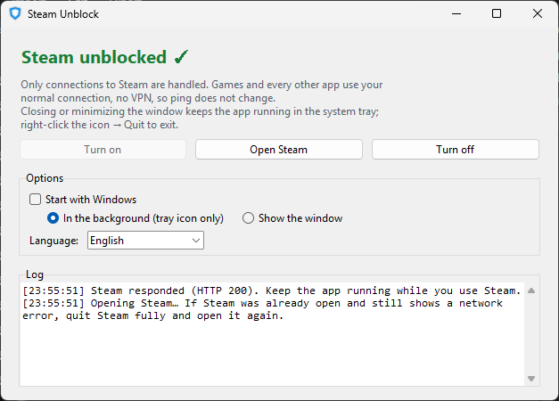
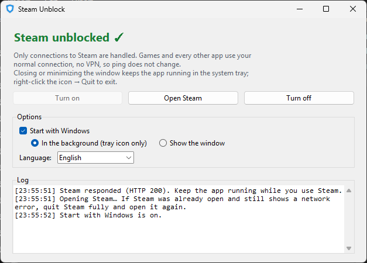
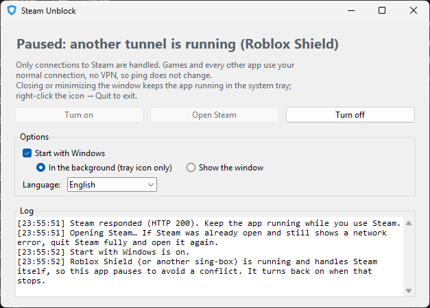

# 🎮 Steam Unblock

**English** · [Tiếng Việt](README.vi.md)

Get into Steam when your ISP blocks it — **without a VPN**, so your in-game ping does not change. Built for Vietnamese ISPs, which block Steam in two ways at once: hijacked DNS (switching to 8.8.8.8 does not help) and DPI that resets connections when it sees a Steam domain.

Windows 10/11 (64-bit) · UI in English and Vietnamese

**Download:** [latest release](https://github.com/Edvat07/SteamUnblock/releases/latest)

---

## Step-by-step guide

### Step 1. Download and extract
1. Open the [latest release](https://github.com/Edvat07/SteamUnblock/releases/latest) and download `SteamUnblock-v*-win64.zip`.
2. Right-click the zip → **Extract All…** → choose a permanent folder, for example `C:\Apps\SteamUnblock`.
3. Keep the `core` folder next to `SteamUnblock.exe` (it contains `sing-box.exe` and `wintun.dll`).

### Step 2. Run the app
1. Open `SteamUnblock.exe`.
2. Windows asks for Administrator rights → click **Yes**. The app needs them to create a virtual network adapter.
3. Wait a few seconds until the green **"Steam unblocked ✓"** appears.

### Step 3. Open Steam
- Click **Open Steam**.
- If Steam was already open and still shows a network error: right-click the Steam tray icon → **Exit**, then open Steam again.

### Step 4 (optional). Background mode and start with Windows
- Click **X** or minimize: the app hides in the system tray (bottom-right of the taskbar, maybe under the `^` arrow) and Steam stays unblocked.
- Click the tray icon to reopen the window. Right-click it → **Quit** to exit completely.
- Tick **Start with Windows**, then choose:
  - **In the background (tray icon only)**: Steam is unblocked as soon as you log in, no window.
  - **Show the window**: the window opens when you log in.

> Start with Windows uses Task Scheduler with the highest privileges, so there is **no** UAC prompt at logon. If you move the app folder later, open the app once from the new place so it updates itself.

### Language
The app follows your Windows display language (Vietnamese Windows → Vietnamese, anything else → English). Change it under **Options → Language**; the app offers to restart to apply it.

---

## How it works
- Steam domains are resolved over **encrypted DNS** (DNS-over-HTTPS to 1.1.1.1), so the ISP cannot fake the answers.
- Steam domains get a **fake IP**, and only that fake range is routed into a virtual adapter. There, the first TLS packet (ClientHello) is **split into several TLS records** so DPI cannot read the domain, and the connection goes **straight out** over your own internet — no relay server.
- Games, voice chat and every other app **never pass through** the app → ping is unchanged.

## Works with Roblox Shield
[Roblox Shield](https://github.com/Edvat07/RobloxVPNShield) unblocks Steam the same way while it runs. When Roblox Shield turns protection on, Steam Unblock **pauses itself** so the two never fight over the network, and **turns back on** when Roblox Shield stops. Nothing to do on your side.

---

## FAQ

**My antivirus flags the exe.**
It is packaged with PyInstaller and asks for Administrator rights, which sometimes causes false positives. All source code is in this repo; you can build it yourself (below).

**Steam Unblock is on but Steam still fails.**
Quit Steam completely (tray icon → Exit) and open it again. If it still fails, press **Turn off** then **Turn on** and check the Log.

**How do I uninstall it?**
Untick *Start with Windows*, quit the app (tray icon → Quit), then delete its folder.

---

## Build from source

Requires Python 3.12.

1. Put `sing-box.exe` (sing-box 1.14.x, windows-amd64, from [sing-box releases](https://github.com/SagerNet/sing-box/releases)) and `wintun.dll` (amd64, from [wintun.net](https://www.wintun.net/)) into a `core\` folder next to the source.
2. Run `build.bat`. The result is in `release\`.

## Third-party components
- [sing-box](https://github.com/SagerNet/sing-box) v1.14.3: GPL-3.0-or-later. Run as a separate program; this project is not affiliated with sing-box.
- [Wintun](https://www.wintun.net/): prebuilt signed DLL, distributed unmodified.
- Steam is a trademark of Valve Corporation. This project is not affiliated with Valve.
