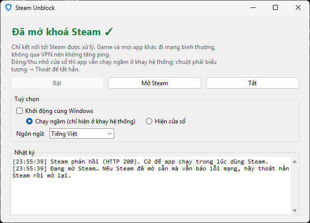
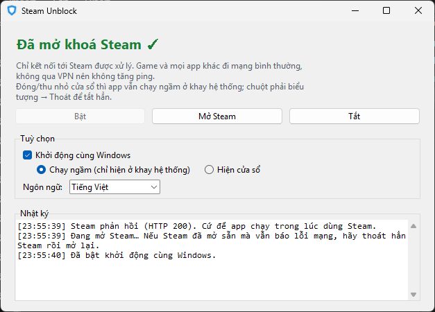
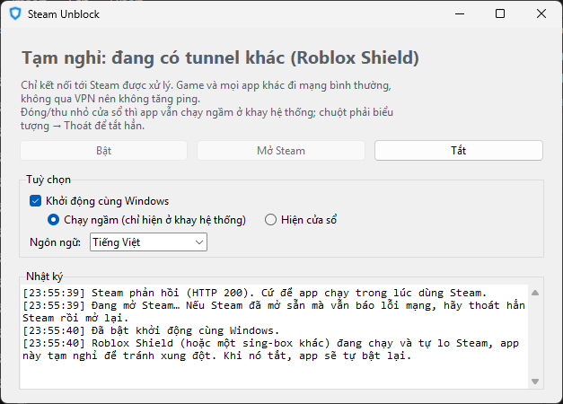

# 🎮 Steam Unblock

[English](README.md) · **Tiếng Việt**

Vào được Steam khi nhà mạng chặn, **không dùng VPN**, nên ping khi chơi game không đổi. Nhà mạng chặn Steam theo **2 lớp** cùng lúc: DNS bị giả mạo (đổi sang 8.8.8.8 cũng không ăn thua) và thiết bị lọc (DPI) ngắt kết nối khi đọc thấy tên miền Steam. App vượt cả hai.

Windows 10/11 (64-bit) · Giao diện tiếng Việt và tiếng Anh

**Tải về:** [bản mới nhất](https://github.com/Edvat07/SteamUnblock/releases/latest)

---

## Hướng dẫn từng bước

### Bước 1. Tải và giải nén
1. Vào [bản mới nhất](https://github.com/Edvat07/SteamUnblock/releases/latest), tải `SteamUnblock-v*-win64.zip`.
2. Chuột phải file zip → **Extract All…** → chọn một thư mục cố định, ví dụ `C:\Apps\SteamUnblock`.
3. Giữ nguyên thư mục `core` nằm cạnh `SteamUnblock.exe` (bên trong có `sing-box.exe` và `wintun.dll`).

### Bước 2. Chạy app
1. Mở `SteamUnblock.exe`.
2. Windows hỏi quyền Administrator → bấm **Yes**. App cần quyền này để tạo card mạng ảo.
3. Đợi vài giây đến khi hiện dòng chữ xanh **"Đã mở khoá Steam ✓"**.

### Bước 3. Vào Steam
- Bấm **Mở Steam**.
- Nếu Steam đã mở sẵn từ trước mà vẫn báo lỗi mạng: chuột phải icon Steam ở khay → **Exit**, rồi mở lại Steam.

### Bước 4 (tuỳ chọn). Chạy ngầm và khởi động cùng Windows
- Bấm **X** hoặc thu nhỏ: app ẩn xuống khay hệ thống (góc phải thanh Taskbar, có thể nằm trong mũi tên `^`), Steam vẫn được mở khoá.
- Bấm icon ở khay để mở lại cửa sổ. Chuột phải icon → **Thoát** để tắt hẳn.
- Tick **Khởi động cùng Windows**, rồi chọn:
  - **Chạy ngầm (chỉ hiện ở khay hệ thống)**: mở máy là Steam được mở khoá luôn, không hiện cửa sổ.
  - **Hiện cửa sổ**: mở máy thì cửa sổ app hiện lên.

> Khởi động cùng Windows dùng Task Scheduler với quyền cao nhất, nên lúc đăng nhập **không** hiện hộp thoại UAC. Nếu sau này bạn chuyển thư mục app đi chỗ khác, hãy mở app một lần ở chỗ mới để nó tự cập nhật.

### Ngôn ngữ
App tự theo ngôn ngữ hiển thị của Windows (Windows tiếng Việt → tiếng Việt, còn lại → tiếng Anh). Đổi ở **Tuỳ chọn → Ngôn ngữ**; app sẽ hỏi mở lại để áp dụng.

---

## Cách hoạt động
- Tên miền Steam được phân giải qua **DNS mã hoá** (DNS-over-HTTPS tới 1.1.1.1), nên nhà mạng không giả mạo được.
- Tên miền Steam nhận một **IP ảo**. Chỉ dải IP ảo đó đi vào card mạng ảo. Ở đó gói TLS đầu tiên (ClientHello) được **chia thành nhiều TLS record** để DPI không đọc được tên miền, rồi kết nối **đi thẳng** ra mạng nhà, không qua máy chủ trung gian nào.
- Game, voice chat và mọi app khác **không đi qua** app → ping không đổi.

## Dùng cùng Roblox Shield
[Roblox Shield](https://github.com/Edvat07/RobloxVPNShield) cũng tự mở khoá Steam theo cách tương tự. Khi Roblox Shield bật bảo vệ, Steam Unblock tự **tạm nghỉ** để hai app không tranh nhau mạng, và **tự bật lại** khi Roblox Shield tắt. Bạn không phải làm gì.

---

## Câu hỏi thường gặp

**Phần mềm diệt virus báo có virus?**
File exe được đóng gói bằng PyInstaller và xin quyền Administrator, nên đôi khi bị báo nhầm. Toàn bộ mã nguồn nằm trong repo này; bạn có thể tự build (xem bên dưới).

**Bật rồi mà Steam vẫn lỗi?**
Thoát hẳn Steam (chuột phải icon ở khay → Exit) rồi mở lại. Nếu vẫn lỗi, bấm **Tắt** rồi **Bật** và xem phần Nhật ký.

**Gỡ app thế nào?**
Bỏ tick *Khởi động cùng Windows*, thoát app (chuột phải icon ở khay → Thoát), rồi xoá thư mục app.

---

## Build từ mã nguồn

Cần Python 3.12.

1. Đặt `sing-box.exe` (sing-box 1.14.x, windows-amd64, tải ở [sing-box releases](https://github.com/SagerNet/sing-box/releases)) và `wintun.dll` (amd64, tải ở [wintun.net](https://www.wintun.net/)) vào thư mục `core\` cạnh mã nguồn.
2. Chạy `build.bat`. Kết quả nằm ở `release\`.

## Thành phần bên thứ ba
- [sing-box](https://github.com/SagerNet/sing-box) v1.14.3: GPL-3.0-or-later. Được chạy như một chương trình riêng, dự án này không liên kết với sing-box.
- [Wintun](https://www.wintun.net/): bản DLL đã ký, phân phối nguyên gốc.
- Steam là thương hiệu của Valve Corporation. Dự án này không liên kết với Valve.
